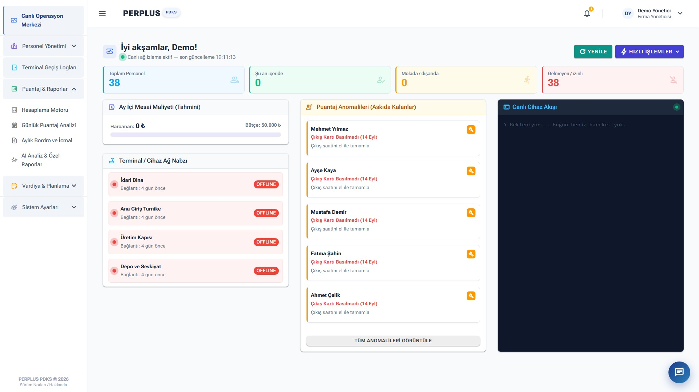
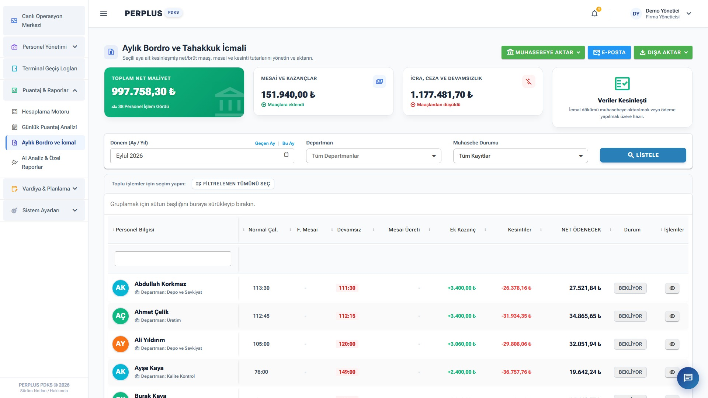
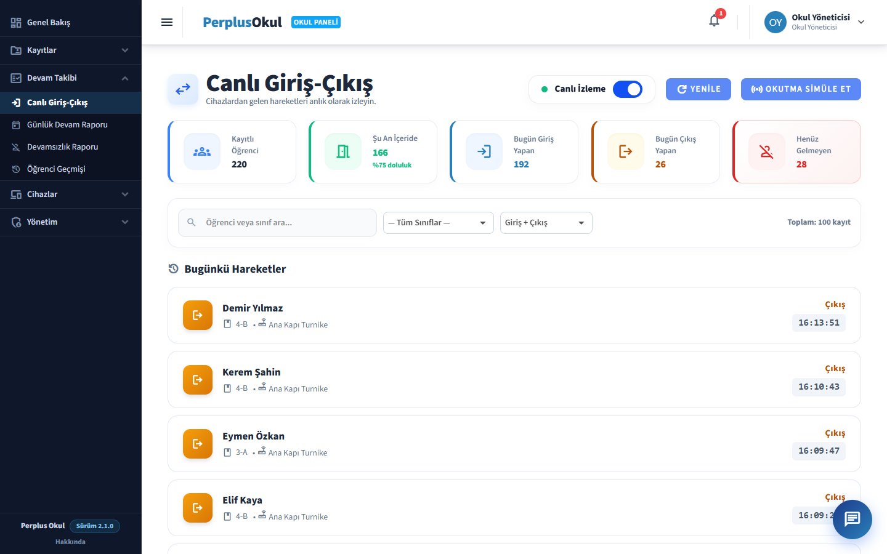
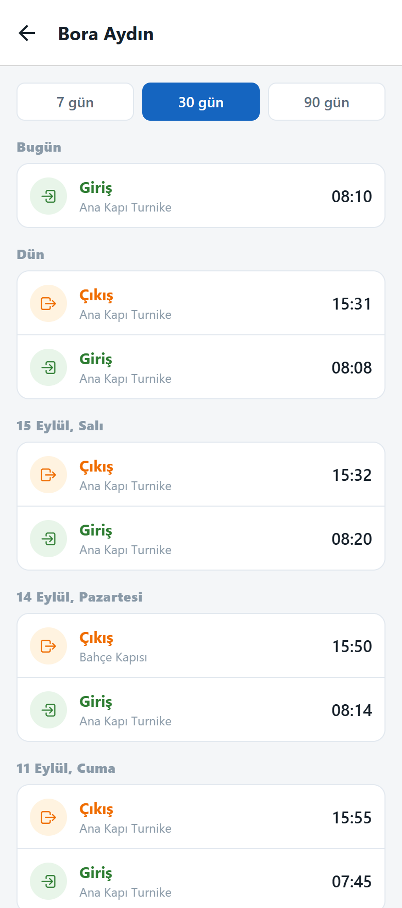

### Merhaba, ben Orkun 👋

Bağımsız yazılım geliştiriciyim. İşletmelerin personel, geçiş ve takip süreçlerini otomatikleştiren masaüstü ve web
yazılımları geliştiriyorum. Perplus markasıyla dağıtılan yazılımların geliştiricisiyim.

İşimi farklı kılan şey, yazılımın sahadaki donanımla ve muhasebe sistemleriyle kesintisiz çalışması: turnike ve kart
okuyucu panelleri, ZKTeco cihazları; Logo, Mikro, Zirve, Paraşüt gibi ERP entegrasyonları.

#### Ürünler

**Web / SaaS** (.NET, Blazor Server, PostgreSQL)
- **PerplusWeb**: PDKS, puantaj ve bordro platformu (canlı operasyon merkezi, vardiya yönetimi, aylık bordro ve icmal)
- **Perplus Öğrenci**: okul giriş-çıkış ve veli bildirim sistemi, Expo ile veli mobil uygulaması ([perplusokul.com](https://perplusokul.com))
- **PerplusAccess**: web tabanlı geçiş kontrol platformu (geliştiriliyor)

**Masaüstü** (WinForms, SQL Server)
- PDKS: personel devam kontrol ve puantaj programı, ERP entegrasyonlarıyla
- Giriş-Çıkış Takip, Öğrenci Takip, Yurt Takip
- KafeTakip: kartlı (ön ödemeli) kafe satış programı
- QR-Bilet: QR kodlu bilet ve giriş programı

**Araçlar**: geçiş panellerini bulut platformlarına bağlayan köprü servisi, lisans üretim ve bayi takip aracı

#### Ekran görüntüleri (demo veri)

| PerplusWeb: canlı operasyon merkezi | PerplusWeb: bordro ve icmal |
| --- | --- |
|  |  |

| Perplus Öğrenci: canlı giriş-çıkış | Perplus Öğrenci: veli uygulaması |
| --- | --- |
|  |  |

#### Teknolojiler

C# · .NET · ASP.NET Core · Blazor Server · Windows Forms · EF Core · PostgreSQL · SQL Server · REST API ·
Clean Architecture · React Native (Expo) · Nginx · Cloudflare · Inno Setup

Kaynak kodları ticari olduğu için depolarım gizli. Programları denemek ya da lisans almak için
[LinkedIn](https://www.linkedin.com/in/orkunbaylan) veya orkunbaylan1@gmail.com üzerinden yazabilirsiniz.

---

🇬🇧 English

I'm Orkun Baylan, an independent developer building desktop and web software that makes everyday business operations
easier. I design and build products such as time & attendance (PDKS), payroll, access control, school entry-exit and
café management end to end. My specialty is making software talk to hardware (turnstiles, card readers, ZKTeco) and to
accounting/ERP systems (Logo, Mikro, Zirve, Paraşüt).

My repositories are private because the code is commercial. Feel free to reach out on
[LinkedIn](https://www.linkedin.com/in/orkunbaylan) to try my programs or get a license.

