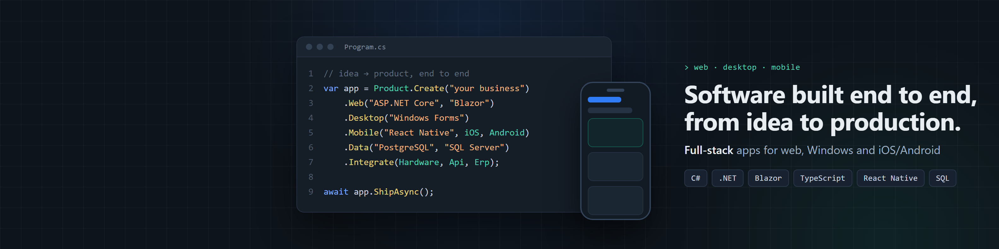

### Merhaba, ben Orkun 👋

Full-stack yazılım geliştiriciyim. İşletmelerin personel, geçiş ve takip süreçlerini otomatikleştiren web, masaüstü ve
mobil (iOS/Android) yazılımlar geliştiriyorum. Perplus markasıyla dağıtılan yazılımların geliştiricisiyim.

İşimi farklı kılan şey, yazılımın sahadaki donanımla ve muhasebe sistemleriyle kesintisiz çalışması: turnike ve kart
okuyucu panelleri, ZKTeco cihazları; Logo, Mikro, Zirve, Paraşüt gibi ERP entegrasyonları. Ürünleri uçtan uca tek
başıma geliştiriyorum: veritabanı tasarımı, arayüz, cihaz haberleşmesi, kurulum, lisanslama ve sunucu.

---

### 🌐 Web / SaaS

#### PerplusWeb: PDKS, puantaj ve bordro platformu · [perpluspdks.com](https://perpluspdks.com) · [kılavuz](https://perpluspdks.com/docs)
Kart okuyucu ve turnikelerden gelen giriş-çıkışları toplar, vardiya ve mesai kurallarına göre puantajı hesaplar,
bordroya hazır veri üretir.
- **Personel yönetimi:** özlük bilgileri, izin ve hakediş, ek kazanç ve kesintiler, tarihli maaş geçmişi; tanınmayan
  kart okutmalarının bekletildiği veri merkezi
- **Puantaj ve raporlar:** terminal geçiş logları, arka planda çalışan hesaplama motoru, günlük puantaj analizi, aylık
  bordro ve icmal (Excel), maaş pusulası, departman maliyeti, performans ısı haritası
- **Vardiya ve planlama:** çalışma grupları, geç kalma/erken çıkma toleransları, gece aralığı, vardiya şablonları ve molalar
- **Canlı operasyon merkezi:** günün anlık durumu tek ekranda; kullanıcı yetkisine göre ekranlar
- 19 dakikalık [eğitim videosu](https://www.youtube.com/watch?v=qMVOepinf0I)

#### Perplus Öğrenci: okul giriş-çıkış ve veli bildirim sistemi · [perplusokul.com](https://perplusokul.com) · [kılavuz](https://perplusokul.com/docs)
Öğrenci okula girdiğinde ya da çıktığında veliye anında bildirim gider; okul yönetimi tüm hareketleri panelden izler.
- **Üç panel:** platform yönetimi, okul paneli, veli paneli (PWA) ve veli mobil uygulaması (React Native / Expo)
- **Okul paneli:** genel bakış ("şu an içeride", henüz gelmeyenler), canlı giriş-çıkış, devamsızlık bildirimi, ders
  programı, elle kayıt (raporlu/izinli)
- **Cihaz altyapısı:** WebSocket ile çalışan cihazlar (ZKTeco vb.) ve yerel köprü üzerinden TCP turnike panelleri
- Canlıda: 15 dakikalık [eğitim videosu](https://www.youtube.com/watch?v=JE4zwpKfh94)

#### PerplusAccess: web tabanlı geçiş kontrol platformu · [perplusaccess.com](https://perplusaccess.com)
Panel merkezli tasarım: geçiş kararını panel verir, internet kesilse de kartla geçiş sürer.
- Kişiler (Excel/CSV ile toplu aktarım), kişi başına birden fazla kart, son kullanma tarihi ve kontör, ziyaretçiler, gruplar
- Kapılar, zaman dilimleri, tatil takvimi ve erişim grupları
- Kart panele yazılır ve geri okunarak doğrulanır; köprü çevrimdışıyken değişiklikler sıraya alınır
- iOS ve Android mobil uygulaması (React Native / Expo, TypeScript)
- Reddedilen geçişler için anlık bildirim, şube ve köprü yönetimi, kişi portalı, raporlar

---

### 🖥️ Masaüstü programları
Windows Forms ile geliştirildi; Inno Setup kurulumu ve lisans anahtarıyla etkinleştirme.

| Program | Ne yapar |
| --- | --- |
| **PDKS** | ZKTeco ve kart okuyuculardan kayıt alır, puantajı hesaplar; Logo, Mikro, Zirve ve Paraşüt'e aktarır |
| **Giriş-Çıkış Takip** | Turnike ve kart okuyucu panellerinden geçişleri toplar; kim ne zaman girdi-çıktı anlık izlenir ve raporlanır |
| **Öğrenci Takip** | Okul, kurs ve yurtlar için: öğrenci kaydı ve fotoğrafı, canlı giriş-çıkış, anti-passback, Netgsm ile veliye SMS, borç ve ödeme takibi, Excel raporları |
| **Yurt Takip** | Öğrenci Takip'in SQL Server tabanlı çok kullanıcılı ağ sürümü; blok, kat ve kapasite yönetimi; sunucu/istemci kurulumu, eksik SQL Server ve .NET'i kurulumda indirir |
| **KafeTakip** | Kafeterya ve kantinler için kartlı (ön ödemeli) satış: kart tanımlama, bakiye yükleme, hızlı sipariş ekranı, iade/iptal, ciro raporları |
| **QR-Bilet** | Bilet türüne göre satış ve QR kodlu bilet; girişte QR okuyuculu turnike doğrular; yerel ağda panel bulma, röle ve saat ayarları |

### 🔧 Altyapı ve araçlar
- **Panel Köprü Servisi:** bulut platformlarının müşterinin yerel ağındaki panellerle konuşması için Windows servisi.
  UDP ile cihaz bulma, TCP ile kart/okuyucu/ayar komutları; buluta dışa doğru WebSocket bağlantısı sayesinde port açmaya
  gerek yok; anahtarla kimlik doğrulama, otomatik yeniden bağlanma ve bir ayar arayüzü.
- **Lisans altyapısı:** bilgisayara bağlı, süreli ve kriptografik olarak imzalı lisans anahtarları; müşteri ve bayi
  kayıtları, lisans iptali, dosya bütünlüğü ve kurcalama koruması.

---

### 📸 Ekran görüntüleri (demo veri)

| PerplusWeb: canlı operasyon merkezi | PerplusWeb: bordro ve icmal |
| --- | --- |
| 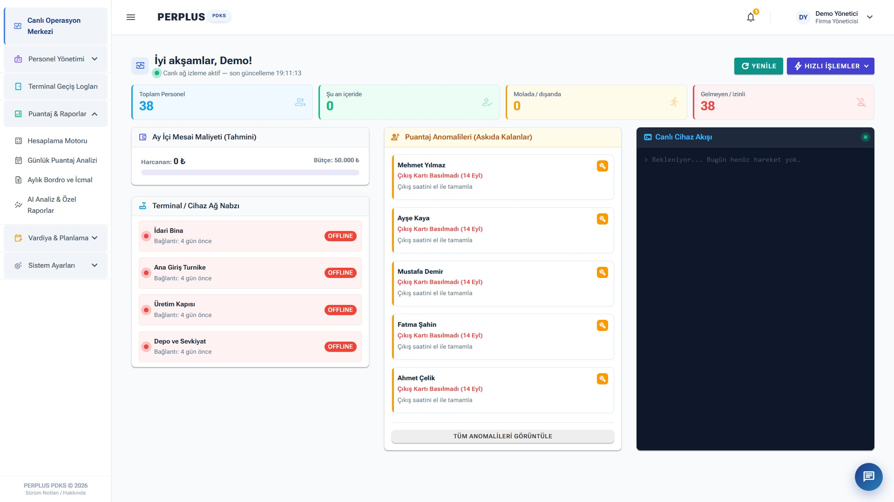 | 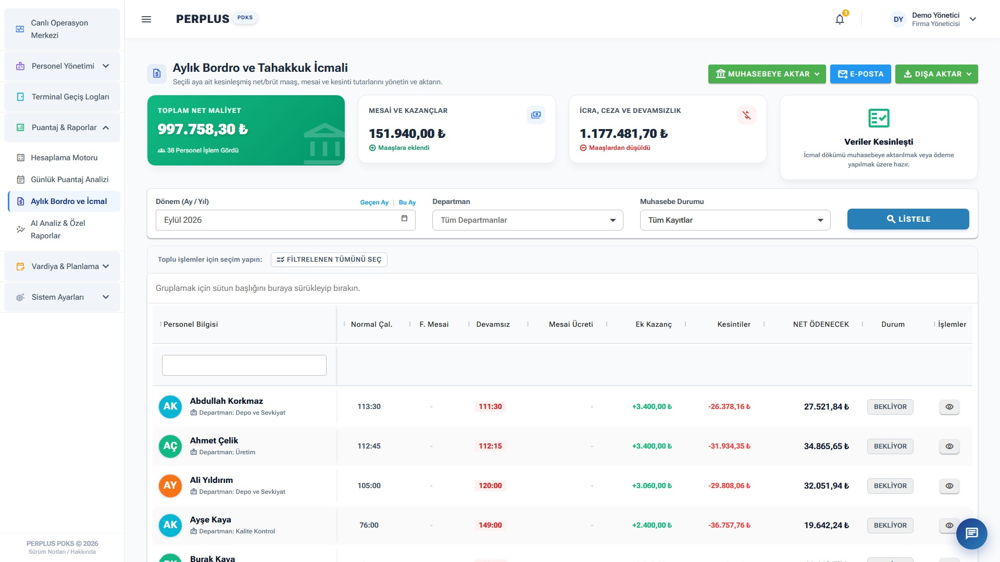 |

| Perplus Öğrenci: canlı giriş-çıkış | Perplus Öğrenci: veli uygulaması |
| --- | --- |
| 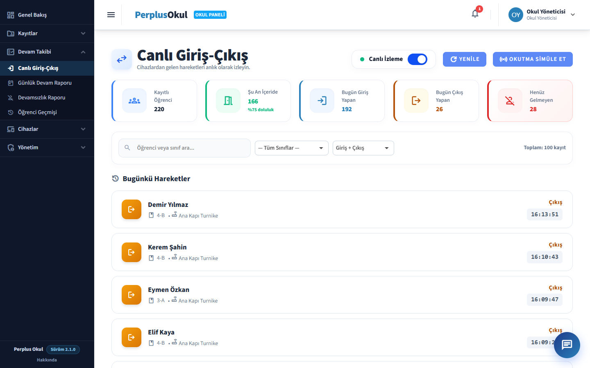 | 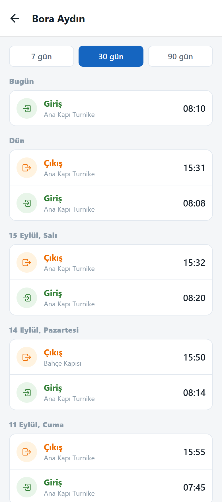 |

| PerplusAccess: genel bakış | PerplusAccess: canlı geçişler |
| --- | --- |
| 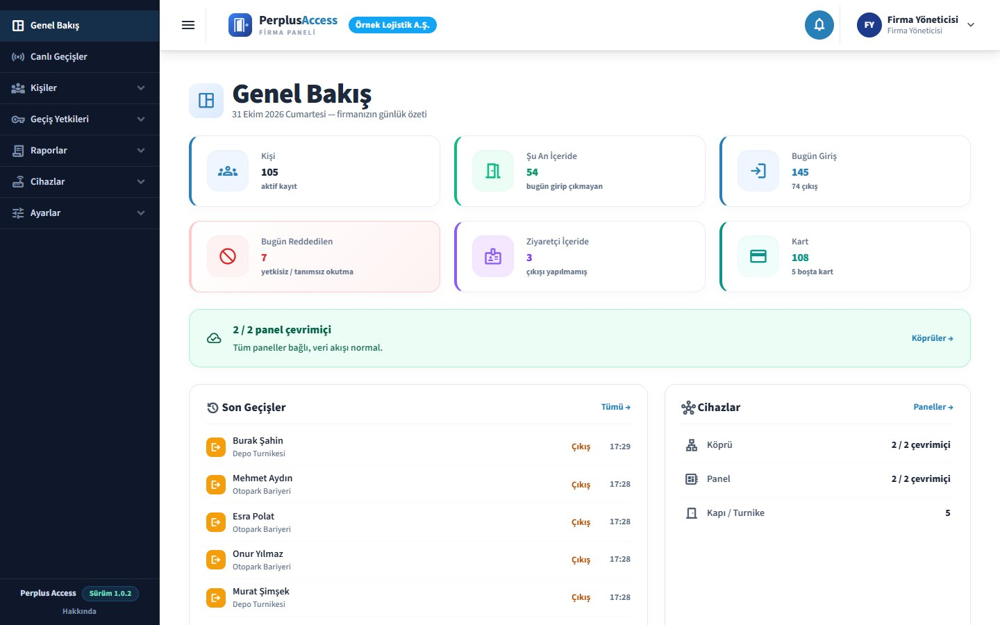 | 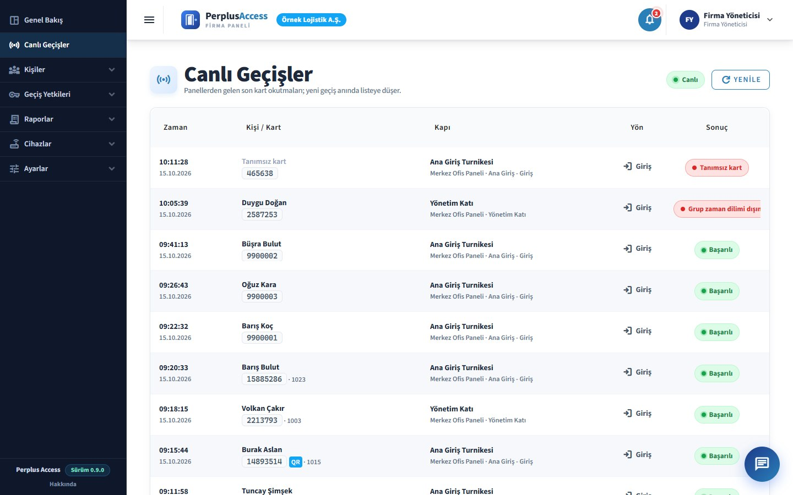 |

| PerplusAccess: kişi profili | PerplusAccess: günlük rapor |
| --- | --- |
| 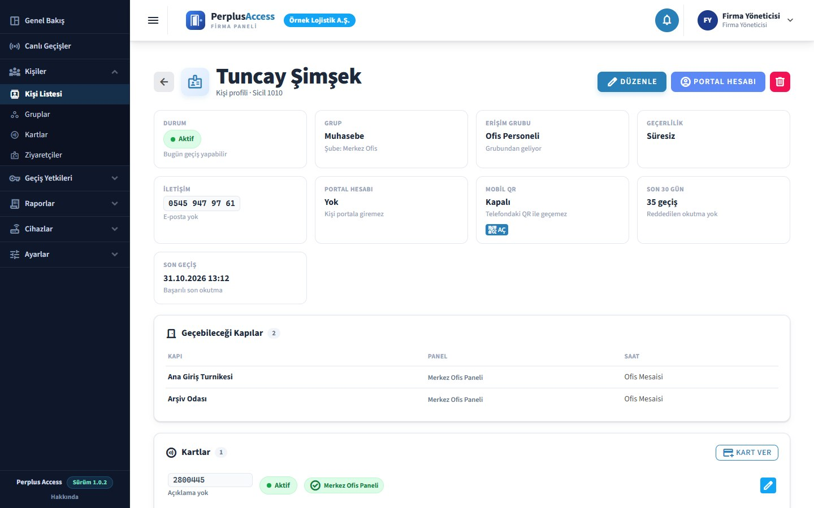 | 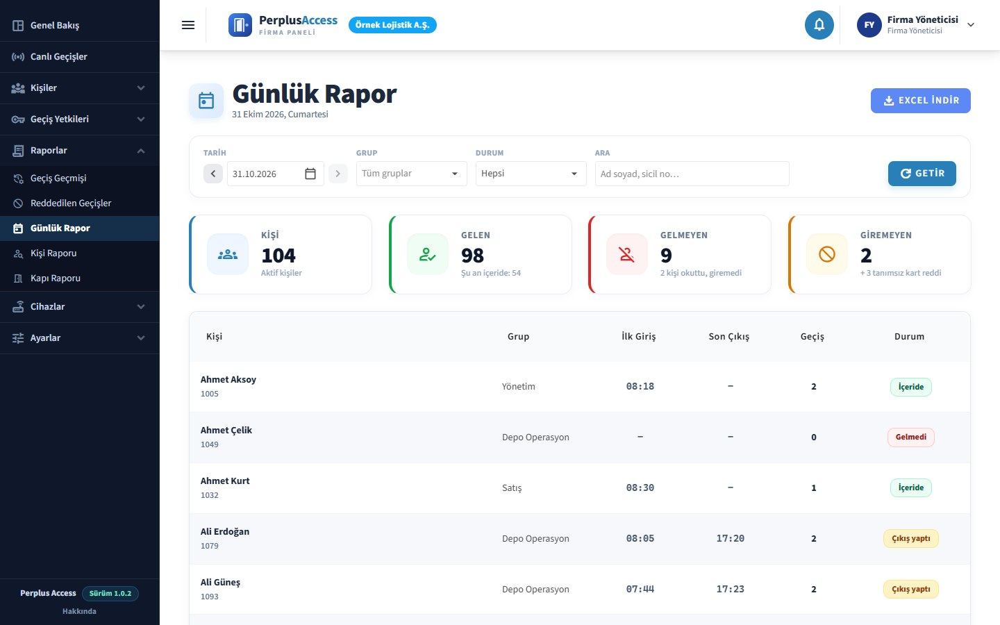 |

| PerplusAccess: paneller ve köprü bağlantısı |
| --- |
| 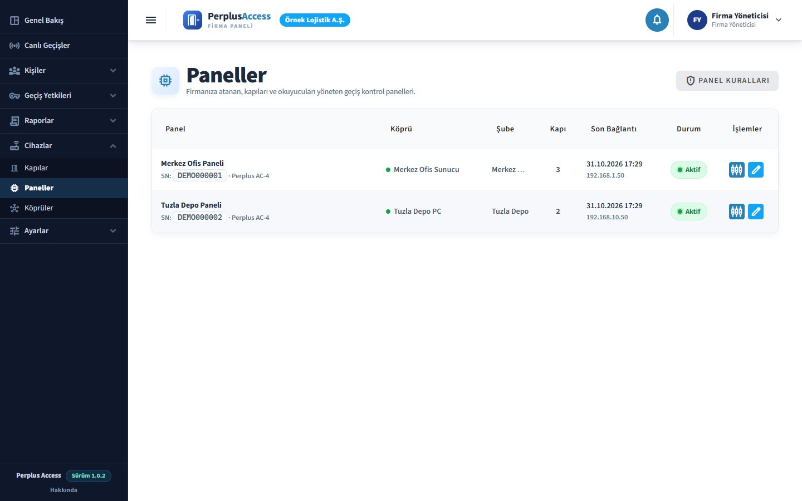 |

| PDKS: aylık puantaj | PDKS: giriş-çıkış |
| --- | --- |
| 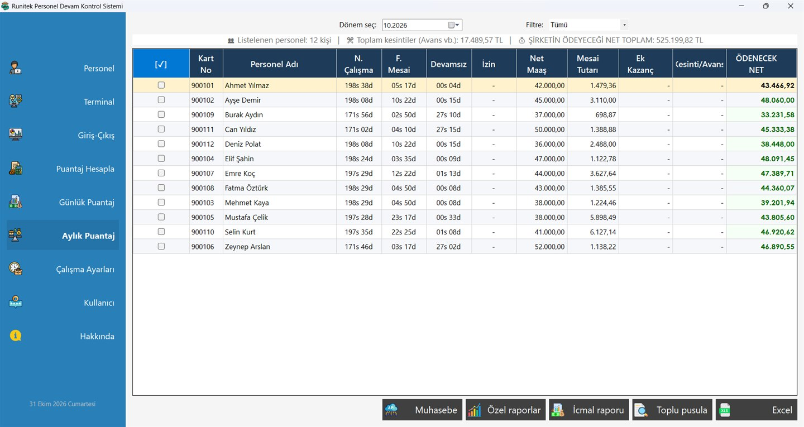 | 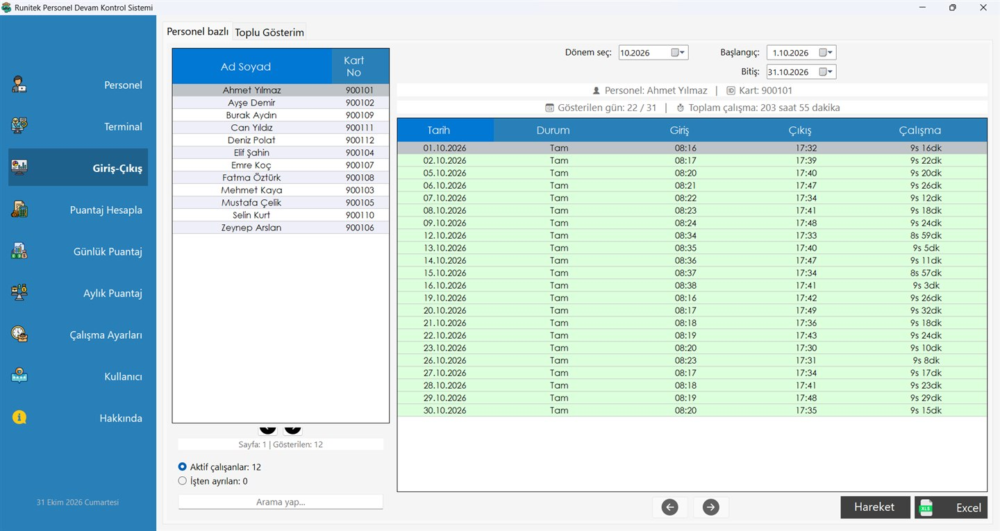 |

| Giriş-Çıkış Takip: personel | Giriş-Çıkış Takip: rapor |
| --- | --- |
| 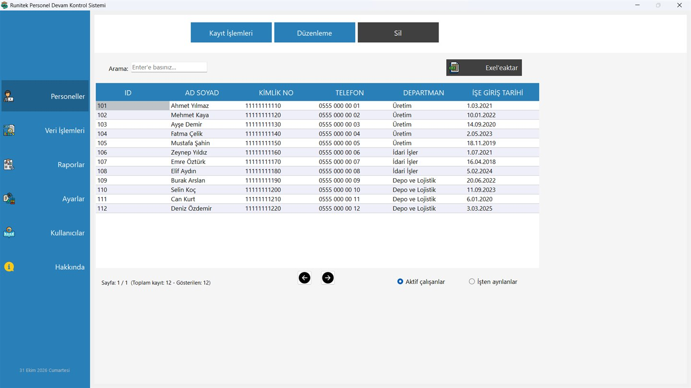 | 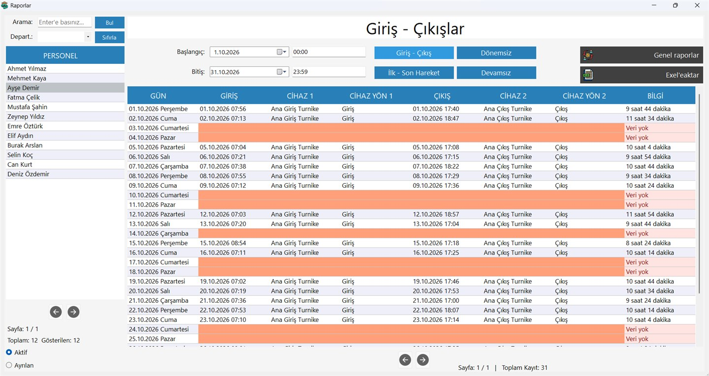 |

| Öğrenci Takip: öğrenci listesi | Öğrenci Takip: giriş-çıkış raporu |
| --- | --- |
| 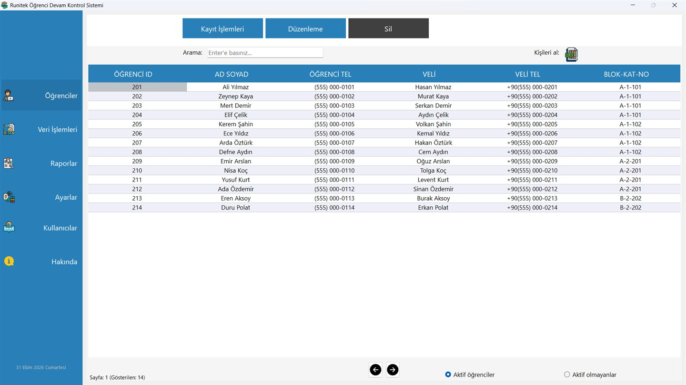 | 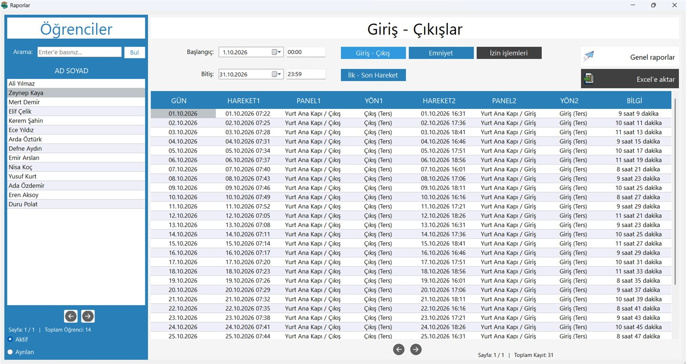 |

| KafeTakip: sipariş ekranı | QR-Bilet: satış ve bilet listesi |
| --- | --- |
| 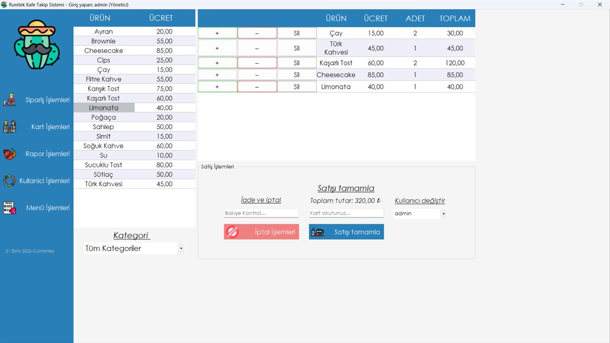 | 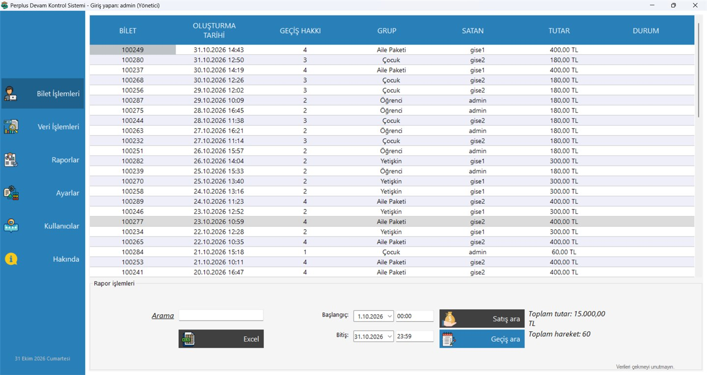 |

### 🧰 Teknolojiler

**Backend:** C# · .NET · ASP.NET Core · EF Core · REST API · WebSocket · TCP/UDP cihaz protokolleri · Clean Architecture · xUnit  
**Arayüz:** Blazor Server · Windows Forms · HTML · CSS · JavaScript · TypeScript  
**Mobil:** React Native (Expo) · TypeScript · iOS · Android  
**Veritabanı:** PostgreSQL · SQL Server · SQLite  
**Altyapı:** Nginx · Cloudflare · Inno Setup · Git

🎬 Eğitim videoları: [YouTube · Geliştirdiğim Yazılımlar](https://www.youtube.com/playlist?list=PLDf1-6sOXCEU)

Kaynak kodları ticari olduğu için depolarım gizli. Programları denemek ya da lisans almak için
[LinkedIn](https://www.linkedin.com/in/orkunbaylan) veya orkunbaylan1@gmail.com üzerinden yazabilirsiniz.

---

🇬🇧 English

I'm Orkun Baylan, a full-stack developer building web, desktop and mobile (iOS/Android) software that automates personnel, access and
tracking operations for businesses. I'm the developer of the software distributed under the Perplus brand, and I build
each product end to end: database, UI, device communication, installer, licensing and server.

My specialty is making software talk to hardware (turnstiles, card-reader panels, ZKTeco devices) and to accounting/ERP
systems (Logo, Mikro, Zirve, Paraşüt).

**Web / SaaS** (.NET, Blazor Server, PostgreSQL)
- **PerplusWeb** ([perpluspdks.com](https://perpluspdks.com)): time & attendance, timesheet and payroll platform:
  personnel records, leave, shifts and tolerances, a background calculation engine, monthly payroll summaries (Excel),
  payslips, department cost and a live operations dashboard.
- **Perplus Öğrenci** ([perplusokul.com](https://perplusokul.com)): school entry-exit system that notifies parents
  instantly; school, platform and parent panels plus a React Native (Expo) parent app.
- **PerplusAccess** ([perplusaccess.com](https://perplusaccess.com)): panel-centric access control
  that keeps working offline; people, cards, visitors, doors, time zones, access groups, branches, real-time alerts
  and an iOS/Android app (React Native / Expo, TypeScript).

**Desktop** (Windows Forms): PDKS with ERP export, Entry-Exit Tracking, Student Tracking (anti-passback, SMS to
parents, payments), Dormitory Tracking (multi-user SQL Server edition), KafeTakip (prepaid card café sales) and
QR-Bilet (QR ticket sales and turnstile validation).

**Tech stack:** C#, .NET, ASP.NET Core, Blazor, Windows Forms, EF Core, TypeScript, JavaScript, React Native (Expo),
HTML, CSS, PostgreSQL, SQL Server, SQLite, xUnit, Nginx, Cloudflare, Git.

**Infrastructure:** a Windows bridge service that connects cloud platforms to on-premise panels over UDP/TCP with an
outbound WebSocket (no port forwarding), and a cryptographically signed, machine-bound licensing system.

🎬 Training videos: [YouTube playlist](https://www.youtube.com/playlist?list=PLDf1-6sOXCEU)

My repositories are private because the code is commercial. Feel free to reach out on
[LinkedIn](https://www.linkedin.com/in/orkunbaylan) to try my programs or get a license.

